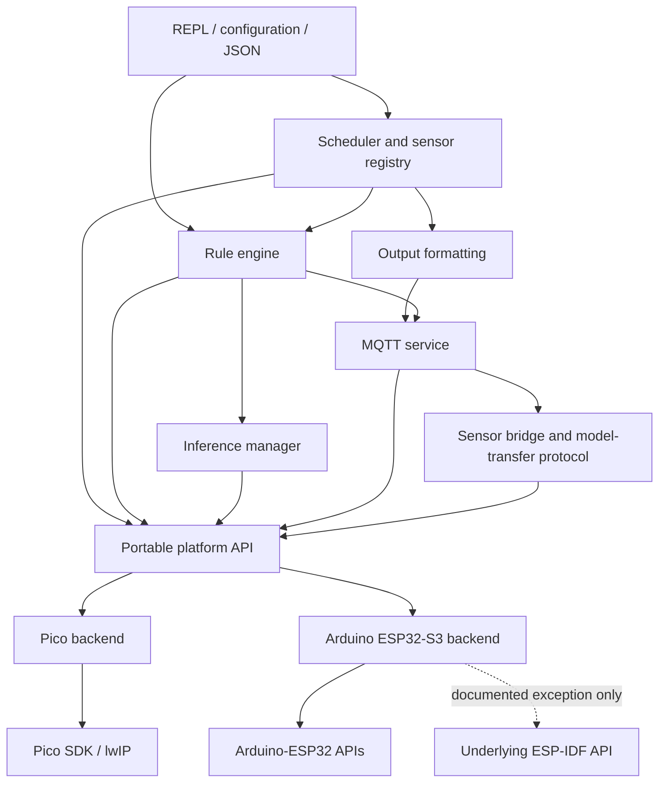
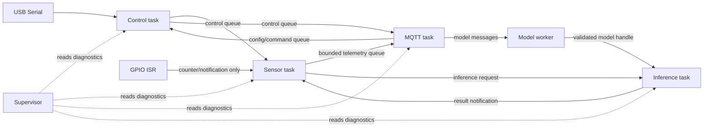
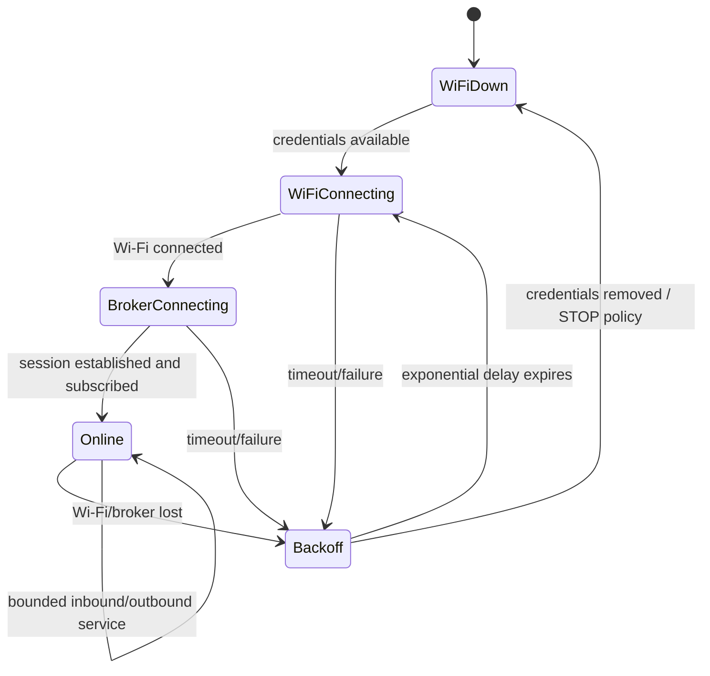

# ESP32-S3 Port Architecture (Task 10 Draft)

Status: **draft for team review; not an architecture freeze**. Tasks 4–9, the decisions in section 10, and the review record in section 11 must be closed before Task 11 changes shared firmware.

This document translates the current Pico implementation and the D1 checklist into a proposed ESP32-S3 design. Values marked **proposed** require measurement on the confirmed board. Values marked **TBD** require a team or hardware decision and must not be inferred by an implementer.

## 1. Scope and invariants

The port preserves these externally visible contracts unless the team records a deliberate deviation:

- The inline configuration and rule syntaxes and the documented MQTT JSON schemas.
- REPL commands and response structure.
- Sensor payload byte order and output formatting.
- Scheduler start/stop/clear semantics and the capacity of at least eight sensors and four rules.
- Rule expression and action semantics.
- MQTT topic structure, presence, heartbeat, configuration, command, event and bridge behaviour.
- Model normalization, threshold masks, score modes and `infer.set` / `infer.run` behaviour.

The ESP32-S3 implementation must not copy shared sources into an Arduino-only fork. Platform-independent code is compiled from one source location by both targets.

## 2. Ownership and review

These assignments reflect only names already present in the checklist. The team must fill every TBD before freezing this document.

| Area | Responsible owner | Reviewer | Evidence / decision |
|---|---|---|---|
| Pico requirements and reference tests | Hasif | Team | `parity/PARITY.md` and `parity/logs/` |
| Arduino environment and physical S3 bring-up | Sitt | Team | `SETUP.md`, compile/upload/serial evidence |
| Final pin and power layout | Sitt | Team | Task 8 table and wiring diagram |
| HAL and Pico backend | TBD | TBD | Task 11 change and Pico parity rerun |
| ESP32-S3 HAL and build | TBD | TBD | Task 12 build and hardware tests |
| FreeRTOS runtime / REPL | TBD | TBD | Task 13 runtime evidence |
| GPIO / scheduler | TBD | TBD | Tasks 14–15 parity rows |
| I2C | TBD | TBD | Task 16 parity rows |
| UART | TBD | TBD | Task 17 parity rows |
| Rules | TBD | TBD | Task 18 parity rows |
| Wi-Fi / MQTT / bridging | TBD | TBD | Task 19 broker and recovery evidence |
| Model storage / inference | TBD | TBD | Task 20 transfer, persistence and timing evidence |
| Release verification | Team | Team | Tasks 21–23 |

## 3. Layering and portability boundary

Shared modules may include ISO C/C++ headers and project headers. They must not include `pico/*`, `hardware/*`, `lwip/*`, `Arduino.h`, `WiFi.h`, `Wire.h` or ESP-IDF headers. Platform and bus backends own those dependencies.

The current Pico source has direct platform coupling in 14 active files. Task 11 must classify each before changing it:

| Coupling | Current files | Intended boundary |
|---|---|---|
| Time, delay and absolute deadlines | scheduler, REPL, rules, inference manager/wrapper, GPIO, UART, MQTT configuration/telemetry | Monotonic time and cooperative-delay API |
| Console | `main.c` and modules using `printf` | Console/write API or an explicitly documented thread-safe logging service |
| GPIO and PWM outputs | GPIO bus and rule actions | GPIO/PWM platform API |
| I2C and UART | bus drivers | Per-platform bus backend behind the existing `bus_t` contract |
| Wi-Fi and MQTT transport | `main.c`, MQTT telemetry | Per-platform network/MQTT service; JSON and topic policy remain shared |
| Flash and critical sections | MQTT model transfer | Bounded model-store backend |
| Pico time type in shared configuration | `include/bus/bus_common.h` | Remove from the shared header; use integer monotonic units |

## 4. Proposed portable interfaces

Task 11 must define exact headers and return codes. The following contract is the review baseline, not final source code.

| Service | Required operations | Contract |
|---|---|---|
| Monotonic time | microseconds, milliseconds, elapsed/deadline checks | Unsigned monotonic values; wrap-safe comparisons; callable from tasks; ISR use explicitly marked per operation |
| Delay/yield | microsecond busy wait, millisecond task delay, yield | Busy wait reserved for bounded sensor pulses; task delay must yield; no unbounded wait |
| Console | initialize, non-blocking read, bounded write/flush | Console and UART sensor ports cannot alias; writes serialized; reads have a timeout or return immediately |
| GPIO | validate pin, input/output, pull, read/write, interrupt attach/detach | Invalid/reserved pins return an error; ISR callback does no blocking work |
| PWM | configure, set duty, stop | Frequency, resolution and duty units are explicit; pin ownership is checked |
| Critical section | enter/exit or lock abstraction | Scope is bounded; flash erase/program must not hide a long global interrupt-off interval |
| Diagnostics | free heap, minimum free heap, task stack high-water mark, reset reason | Used only for verification/supervision; unsupported metrics return a documented value |
| Model store | capacity, erase/begin, sequential write, finish/verify, map/read, invalidate | Bounds and alignment checked; incomplete or corrupt data never becomes active |

I2C, UART, Wi-Fi and MQTT remain platform services but should not be forced into a generic byte-level HAL if doing so erases required semantics. They keep typed backends with shared configuration structures and explicit timeout/error contracts.

## 5. Proposed FreeRTOS runtime

Priorities and stack sizes below are starting values. Task 13 records actual stack high-water marks and changes them before acceptance. On ESP32-S3, application work should prefer core 1 so the Arduino/ESP network stack can use its configured system core; final affinity depends on the pinned Arduino core and is verified rather than assumed.

| Task | Responsibility and exclusive ownership | Trigger / maximum block | Priority | Initial stack | Affinity |
|---|---|---|---:|---:|---|
| Supervisor | startup state, watchdog supervision, health/resource snapshot | 1 s periodic; never blocks on a worker | 4 | 3072 B | Core 1 proposed |
| Control | USB console input, REPL parsing and control commands | event/poll; 50 ms maximum read wait | 3 | 4096 B | Core 1 proposed |
| Sensor | sensor registry, schedule deadlines, bus dispatch and local rule trigger | nearest deadline; 10 ms maximum idle wait | 3 | 6144 B | Core 1 proposed |
| MQTT service | connection state, subscriptions, inbound/outbound queues and backoff | event plus 100 ms service timeout | 2 | 6144 B | Unpinned proposed |
| Inference | model invocation and inference actions | notification; bounded by NFR latency | 2 | 8192 B proposed, measure | Core 1 proposed |
| Model worker | model-transfer state, validation and storage writes | chunk/control queue; finite write timeout | 1 | 6144 B | Core 1 proposed |

Arduino `loop()` is a non-blocking supervisor hook or a short `vTaskDelay`; it does not run a second scheduler or perform sensor/network work.

## 6. Queues, locks, notifications and ISR rules

Proposed rules:

- Queue capacities and overflow policies are named constants and have saturation tests. Control/configuration messages are rejected with an observable error rather than silently overwritten. Telemetry may use a documented drop-oldest policy only if the dropped count is exposed.
- The MQTT callback copies a bounded message into a queue and returns. It does not parse configuration, touch sensors, run rules, write flash or invoke ML.
- The GPIO ISR increments an atomic counter or sends an ISR-safe notification. It does not log, allocate, sleep or access MQTT.
- I2C has one bus mutex per controller; UART instances have exclusive owners; console serial is never reused as a sensor port.
- Model activation is an atomic handle/state transition after size, CRC and model validation. Inference never reads a region being erased or written.
- No task waits forever. Every queue, mutex, bus transaction and network operation has a bounded wait and an error path.

Final queue lengths, item sizes and memory cost are recorded after the board memory in Task 8 is confirmed.

## 7. System and subsystem statecharts

### System

```mermaid
stateDiagram-v2
    [*] --> Boot
    Boot --> SafeIdle: platform and shared services ready
    Boot --> Fault: unrecoverable platform/init error
    SafeIdle --> Running: RUN
    Running --> SafeIdle: STOP
    SafeIdle --> SafeIdle: configure / clear
    Running --> Running: sample / rule / telemetry
    Running --> Degraded: recoverable bus or network failure
    Degraded --> Running: service recovered
    Degraded --> SafeIdle: STOP
    SafeIdle --> UpdatingModel: valid model/start
    Running --> UpdatingModel: valid model/start; sampling policy TBD
    UpdatingModel --> SafeIdle: verified and activated
    UpdatingModel --> Degraded: rejected/interrupted/corrupt
    Fault --> SafeIdle: explicit recovery if safe
```

### Scheduler and sensors

```mermaid
stateDiagram-v2
    [*] --> Empty
    Empty --> Configured: valid configuration
    Configured --> Sampling: RUN
    Sampling --> Configured: STOP
    Sampling --> Due: monotonic deadline reached
    Due --> Sampling: sample emitted; next deadline advanced
    Due --> SensorError: timeout/NACK/framing/read error
    SensorError --> Sampling: retry policy permits
    SensorError --> Configured: sensor disabled or STOP
    Configured --> Empty: CLEAR
    Sampling --> Empty: CLEAR after serialized stop
```

Deadline advancement uses the previous scheduled deadline where possible, not `now + period`, to avoid cumulative drift. Overrun policy and missed-deadline counters are decided in Task 10 and tested in Tasks 14 and 21.

### Wi-Fi and MQTT

Backoff is bounded exponential with jitter. Proposed initial/final bounds are 1 s and 30 s; the team confirms them in NFR review. Birth/presence is republished and subscriptions restored after reconnect.

### Model transfer

```mermaid
stateDiagram-v2
    [*] --> NoCandidate
    NoCandidate --> Receiving: valid start and size within capacity
    Receiving --> Receiving: next bounded chunk accepted
    Receiving --> Verifying: end and expected byte count received
    Receiving --> Rejected: timeout/order/overflow/interruption
    Verifying --> Ready: CRC and model validation pass
    Verifying --> Rejected: size/CRC/schema/allocation failure
    Ready --> Active: atomic activation
    Rejected --> NoCandidate: candidate invalidated
    Active --> Receiving: replacement start; active model retained
```

A new transfer never destroys the last known-good active model until the replacement has passed all checks. Persistence across reset requires an on-flash header with magic, format version, size, CRC and committed state.

## 8. Hardware and pin allocation gate

No ESP32-S3 GPIO number is approved in this draft. Task 8 must supply:

| Function | Required electrical/ownership constraint | Selected pin |
|---|---|---|
| USB console | Must match the actual native USB or bridge path | TBD |
| I2C SDA/SCL | Same controller; pull-ups and voltage documented | TBD / TBD |
| Sensor UART TX/RX | Must not conflict with console; voltage documented | TBD / TBD |
| GPIO digital/counter | Interrupt-capable if counter uses an ISR | TBD |
| HC-SR04 Trig/Echo | Echo uses a verified 5 V-to-3.3 V divider/level shifter | TBD / TBD |
| DHT22/AM2302 data | Pull-up and minimum sample interval documented | TBD |
| Rule GPIO/PWM | LEDC-capable and not reserved/strapping | TBD |

The final table cites the exact board pinout and records module marking, flash, PSRAM, strapping/reserved pins, current limits and sensor power rails.

## 9. Assumptions and risks

| Assumption / risk | Impact | Validation | Owner / gate |
|---|---|---|---|
| The marketed “ESP32-S3 Super Mini” variants are not electrically identical | Wrong flash/PSRAM/USB/pin settings can brick bring-up or damage a pin | Read markings, cite matching schematic/pinout, run USB and memory probe | Sitt / Task 8 |
| Arduino-ESP32 version changes APIs and default USB/network behaviour | Non-reproducible builds and serial failures | Pin IDE, core, FQBN and every menu option | Sitt / Task 7 |
| Pico defects are not automatically desirable parity | Reproducing invalid-input bugs creates unsafe behaviour | Decide D-01–D-06 individually and record expected S3 result | Team / Task 10 |
| Busy-wait DHT22 and HC-SR04 code can starve tasks/watchdog | Resets, MQTT loss or jitter | Measure worst case; use peripheral/ISR strategy if cooperative bound fails | GPIO owner / Task 15 |
| Arduino MQTT callbacks may run in a different context than Pico lwIP callbacks | Races and unsafe blocking | Callback only queues bounded copies; saturate queue under test | MQTT owner / Task 19 |
| TFLite Micro integration and arena requirements are not yet known | Build incompatibility or insufficient RAM | Compatibility spike after core/module pin; record arena and minimum heap | ML owner / Task 20 |
| Flash writes and partition choice can corrupt firmware or active model | Device fails to boot or loses model | Dedicated partition, bounds checks, two-phase commit and interrupted-upload tests | ML owner / Task 20 |
| Current Pico timing is capped near 1 Hz by a fixed delay | Blindly matching it defeats requested frequencies | Treat as D-06 and approve a corrected S3 timing contract | Team / Tasks 10/14 |

## 10. Decisions required before freeze

| ID | Decision | Options / required evidence | Status |
|---|---|---|---|
| A-01 | Exact ESP32-S3 board, memory and Arduino profile | Task 8 physical evidence | Open |
| A-02 | Arduino IDE/core version and reproducible CLI policy | Task 7 agreement and compile evidence | Open |
| A-03 | D-01–D-06 parity policy | Preserve, fix, or document unsupported for each defect | Open |
| A-04 | Task owners and reviewers | Fill all TBD rows in section 2 | Open |
| A-05 | RTOS priorities, stack sizes, affinities and queue capacities | Build-time memory budget and measured prototype high-water marks | Open |
| A-06 | Scheduler overrun and missed-sample policy | Requirements and overload test | Open |
| A-07 | MQTT library, reconnect bounds and queue overflow policy | Compatibility spike and fault-test plan | Open |
| A-08 | ML library, tensor arena and model partition layout | Compatibility/memory spike on confirmed module | Open |
| A-09 | Continuous-run duration and pass limit | Team-agreed NFR, power/network test availability | Open |
| A-10 | Allowed underlying ESP-IDF exceptions | One justification and test per exception | Open |

Likely exception candidates are partition access for safe model storage, watchdog/heap/task diagnostics, and a peripheral API only if a measured Arduino limitation prevents a requirement. They are not approved merely by appearing here.

## 11. Review and change control

The team completes this table during the architecture review. An approval is valid only against a commit hash containing the reviewed requirements, pin layout and this document.

| Reviewer | Areas checked | Result / required change | Date | Reviewed commit |
|---|---|---|---|---|
| TBD | Requirements and defect policy | Pending | TBD | TBD |
| TBD | Hardware, pins and power | Pending | TBD | TBD |
| TBD | HAL and RTOS/concurrency | Pending | TBD | TBD |
| TBD | MQTT and model safety | Pending | TBD | TBD |

After freeze, a material change to ownership, a public interface, pin mapping, task/queue topology, partition layout, timing target or defect policy requires a decision-log entry with the reason, affected requirements/tests, reviewer and commit.

## 12. Traceability to implementation

| Design area | Implementation task | Verification |
|---|---:|---|
| Portable service contract and Pico backend | 11 | Pico parity rerun |
| Arduino service backend and shared build | 12 | Both builds plus hardware timing/console tests |
| RTOS topology, REPL and supervision | 13 | REPL, stack, watchdog and interaction rows |
| Scheduler/GPIO | 14–15 | Digital, timing, pulse, counter and one-wire rows |
| I2C / UART | 16–17 | Normal and fault rows per bus |
| Rules | 18 | Every action and true/false expression rows |
| Wi-Fi/MQTT/bridge | 19 | Broker, recovery, malformed and saturation rows |
| Model storage/inference | 20 | Valid/invalid/interrupted transfer, persistence, memory and latency rows |
| Integrated limits and endurance | 21 | Full requirements matrix |
| As-built design and exceptions | 22 | Consistency review |
| Reproducible release | 23 | Clean-environment build and smoke test |
